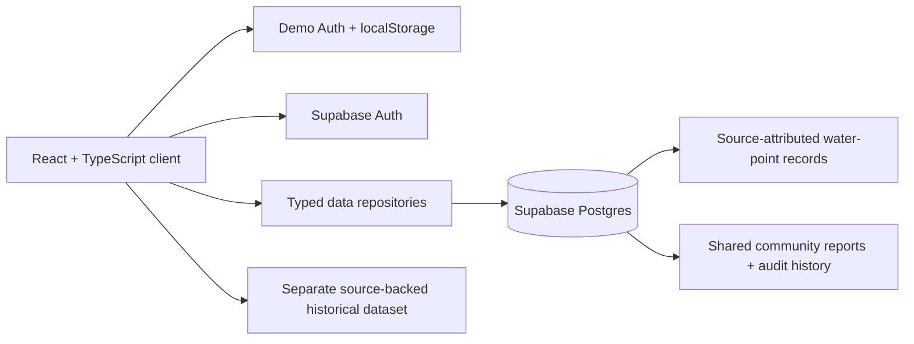

# AquaTrace

**Track the problem. Find the next step.**

AquaTrace is a South African civic-tech prototype for reporting water-service interruptions, following community report updates, reviewing dated source-backed incident notices, and exploring sourced alternative water-point information. It is an information and coordination concept—not a municipal service, outage detector, water-quality authority, or guarantee that water is available.

## What works in this prototype

- **Authentication modes:** browser-only demonstration login by default; optional Supabase Auth when a project is explicitly configured.
- **Role-aware workspace:** resident reporting and viewing; reviewer status review; administrator access to supported review and account-role controls. Supabase mode enforces role permissions with RLS and checked database functions; demo roles are only client-side examples.
- **Reports:** browser-local submissions in demo mode. With configured Supabase and the unapplied schema migration installed, signed-in reports can be shared, refreshed, reviewed and tracked in status history.
- **Local report import:** explicit user-initiated import from the current browser; it is not automatic. Imported records are Unverified, retain their prior displayed date as a label, and do not treat local review notes as authenticated evidence.
- **Historical incidents:** a separate, read-only dataset with direct sources and publication-time context. It is not merged with community reports and is not live service status.
- **Water points:** demo mode contains clearly fictional sample entries. The connected directory has no seeded places; reviewers can add only source-attributed entries, which begin unverified with availability unknown.
- **Insights:** summaries of the records available to the selected mode. Sparse historical coverage and report counts are not outage-frequency or impact measurements.

## Run locally

Requirements: Node.js and npm.

```powershell
npm install
npm run dev
```

By default, the app opens in **demonstration mode**. Example credentials (public, intentionally insecure demo values):

| Role | Email | Password |
|---|---|---|
| Resident | `resident@aquatrace.demo` | `Aqua123!` |
| Incident Reviewer | `reviewer@aquatrace.demo` | `Review123!` |
| Administrator | `admin@aquatrace.demo` | `Admin123!` |

These are not real accounts. Demo sessions are in browser storage, reports remain in that browser, and roles can be manipulated by the browser user. Do not enter real personal data or passwords.

## Optional shared backend

No Supabase project is connected and the schema migration has not been applied. To prepare a project, copy `.env.example` to `.env.local`, configure that project's URL and public client key, then follow [Supabase setup](docs/supabase-setup.md). Never use a service-role or secret key in a browser environment variable. Review the migration before applying it to any project.

Without a configured and migrated project, account registration/recovery, cross-user sharing, database-backed role enforcement, shared water-point verification, and account-role management cannot be tested end-to-end.

## Architecture and evidence boundaries



The browser-only mode supports demonstrating existing workflows; it is not secure authentication or shared storage. In the proposed connected mode, server-side row-level security and role-checked functions are the authorization boundary. Historical source records remain separate from mutable community report workflows. Read [system design](docs/system-design.md) for role boundaries, feedback loops, risks, and validation status.

## Quality checks

```powershell
npm run lint
npm run build
```

No automated browser or live Supabase integration suite is configured. A [user-testing plan](docs/user-testing-plan.md) and blank [results template](docs/user-testing-results-template.md) are provided; no user sessions or findings are claimed.

## Challenge alignment and evidence gaps

The repository names the **Credify System Thinking Challenge 2026**, but does not contain its official brief, categories, or judging criteria. AquaTrace's challenge area must be confirmed against that brief; this project does not guess or claim an official category. There is also no verified water-point dataset or actual user-value testing. See the [pitch outline](docs/pitch-outline.md) and [research backlog](docs/research-backlog.md) for pending evidence.

## Scope and limitations

AquaTrace does not repair water infrastructure, independently verify community observations, guarantee water-point availability, or transmit reports to municipalities. Supabase migration, Auth settings, RLS policy validation, and deployment require project-owner setup and remain unperformed.
