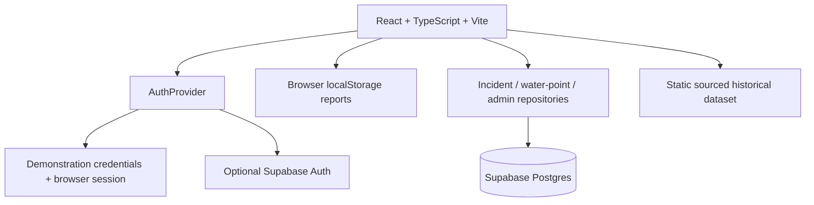

# AquaTrace system design

## Purpose and evidence boundary

AquaTrace explores whether a shared, carefully labelled information workflow can help residents report water-service interruptions, follow review updates, and find sourced information about alternatives. The underlying needs and value proposition remain hypotheses: there are no user interviews, usability sessions, partner commitments, or impact results in the repository.

The app is not an outage detector, engineering diagnosis, municipal channel, emergency service, water-quality authority, or guarantee of current water availability. A community observation is not proof of an outage. A workflow state is not an official service determination.

## Current architecture and modes

By default, the app uses the demonstration account list and browser storage. This mode is intentionally not secure: the client contains the public demo credentials, the session is editable, and the records are not shared across browsers. The optional Supabase client is activated only when both `VITE_SUPABASE_URL` and `VITE_SUPABASE_ANON_KEY` are configured. The migration in `supabase/migrations/` is prepared but unapplied; no project credentials were supplied. A configured browser key is public, so database RLS and server-side RPC role checks—not client visibility—must enforce access.

`src/auth/AuthProvider.tsx` centralizes mode selection, session loading, registration, login, recovery, logout, and account role resolution. `src/data/incidentRepository.ts`, `waterPointRepository.ts`, and `adminRepository.ts` isolate Supabase calls. Historical incidents remain a static read-only dataset in `src/data/historicalIncidents.ts`. Existing local reports are preserved; their shared import requires explicit user action and is idempotent by their local ID.

## Roles and authorization

| Capability | Resident | Reviewer | Administrator |
|---|---:|---:|---:|
| View dashboard, community reports, history, insights, water-point directory | Yes | Yes | Yes |
| Submit community report | Yes | Yes | Yes |
| Review incident and change its status with explanation | No | Yes | Yes |
| Add/review a sourced water point | No | Yes | Yes |
| View account role and audit controls | No | No | Yes |
| Change another user's role with an explanation | No | No | Yes |

Demo mode applies navigation and control visibility in the client only. It demonstrates role-specific workflows but is not an authorization boundary. Supabase mode gives new accounts the resident role; the project owner must bootstrap the first admin. RLS denies direct client mutations to review fields, while security-definer RPCs verify reviewer/admin authority and atomically append history. Role assignment has a separate admin-checked RPC and role-change history. The RPC blocks self-role changes and demotion of the final administrator.

## Data domains and status semantics

- **Community incidents:** mutable observations submitted by authenticated users (or browser-local demo submissions). A new shared incident is `unverified`; it has a generated public identifier, reporter, timestamps, and an idempotency key.
- **Incident status:** describes the workflow (`Unverified`, `Under review`, `More information requested`, `Confirmed`, `Resolved`, `Rejected`). It does not by itself establish the incident as true or a repair as complete.
- **Verification classification:** separately records `unverified`, `reviewed`, `corroborated`, or `externally_verified`. `reviewed` means a designated AquaTrace reviewer examined the report, not that an external authority verified it. Corroborated/external classifications require an HTTPS evidence URL in the database function; provenance still needs human interpretation.
- **Status history:** records prior/new workflow and classification values, reviewer identity, explanation, evidence URL, and timestamp. Shared review writes the incident update and history in one database transaction. Local mode keeps its existing client-side history and 240-character note constraint.
- **Historical incidents:** a separate, read-only and sparsely populated dataset with original source links, publication context, and evidence classification. It is not merged into community data, and publication-time status is not live status.
- **Water points:** connected records require an original HTTPS source and begin `unverified` with availability `unknown`. Verification of a location is distinct from an availability observation, both with timestamps and history. No locations or coordinates have been seeded because a verified source dataset has not been established. Demo-mode examples are explicitly fictional.
- **Profiles and role audit:** the auth trigger creates a resident profile and records that initial role. Admin changes include an explanation and are auditable. First-admin bootstrap must be performed by the project owner.

## Shared reporting flow (requires setup)

1. Supabase Auth authenticates the person; the app loads the profile role before rendering the workspace.
2. The resident submits a report; RLS allows insert only for their own reporter ID and the initial unverified state.
3. The repository requests shared reports and status history. The UI refreshes shared records periodically; it does not use a realtime subscription.
4. A reviewer/admin uses the `review_incident` RPC. The database checks role, input, and evidence constraints, locks the incident, updates it, and appends history transactionally.
5. Local reports are not auto-uploaded. An explicit import RPC reattributes each report to the signed-in importer, retains original date fields and the demo-account label where available, resets it to Unverified, and does not import unauthenticated local review history. Reports created before local reporter IDs were recorded cannot recover that identity. A unique local identifier makes repeated imports idempotent. Local browser data remains in place.

Network failures are shown as errors rather than silently switching shared mutations to local writes. Since this mode is not connected, offline retry/reconciliation and live database behavior still need project-level validation.

## System relationships and feedback loops

**Intended reinforcing loop (hypothesis):** a useful report flow may increase structured observations; reviewer explanations may make updates more understandable; clearer updates may support trust and continued reporting. This loop depends on sufficient participation, timely review, accurate locations, and trustworthy sourcing. None of those conditions has been tested.

**Potential balancing loop:** more submissions may increase duplicate triage and reviewer workload; slower updates can reduce usefulness and participation. A pilot should track completeness, duplicate handling, review workload and delays before promoting broad adoption.

**Evidence/availability loop:** a source can support that a water point exists or was described at a certain date, while a later availability update can become stale. The UI and data model therefore distinguish location verification from availability and timestamps; neither is a guarantee of current water.

**Coverage bias loop:** more connected or media-covered areas may produce more reports and historical entries, appearing more affected in app summaries. Counts reflect entered records, not true outage incidence. Small or uneven datasets must not be used to rank municipalities or infer need.

## Dependencies and risks

- Supabase project, email configuration, correct origins, applied schema, first-admin bootstrap, and reviewed access policies are prerequisites for shared use.
- Migration and RPCs are not yet exercised against PostgreSQL/Supabase. Validate on a disposable project before production consideration.
- No source-backed water-point registry, current water availability feed, municipal integration, moderation policy, privacy review, or deployment is configured.
- The browser client cannot protect demo credentials or local role state. Never reuse demo passwords or present demo mode as production access management.
- Shared history and role-audit retention, data deletion, abuse reporting, rate limits, privacy/legal basis, backups and recovery need project policy before real data collection.
- Realtime subscriptions are not configured; shared reports refresh on a polling interval. Network interruption and retry behavior need live integration tests.
- Two dated official City of Tshwane notices are currently included; historical coverage is sparse and non-exhaustive. Source inclusion does not independently verify cause, household impact or restoration.
- The official Credify challenge brief/category/judging requirements are absent. Challenge alignment remains unconfirmed and must not be guessed.

## Evaluation plan, not results

Proposed measures include usable report completeness, duplicate review burden, review time/errors, participant understanding of evidence labels, data persistence after restart, and misunderstandings about municipal confirmation or water-point availability. A consent-based formative task plan is in [user-testing-plan.md](user-testing-plan.md); the blank results form is [user-testing-results-template.md](user-testing-results-template.md). No sessions have been conducted; no user value or impact is established.
